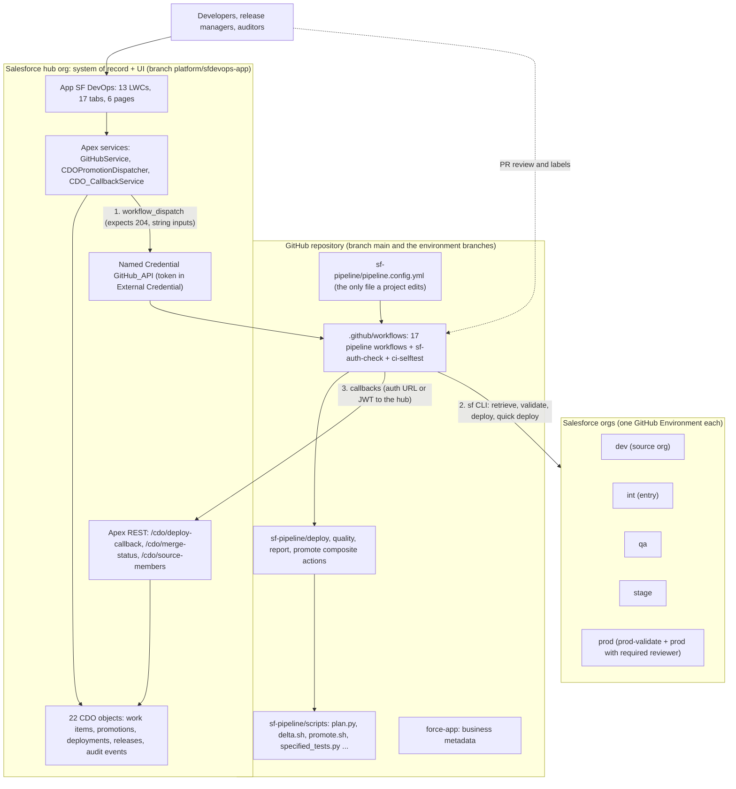
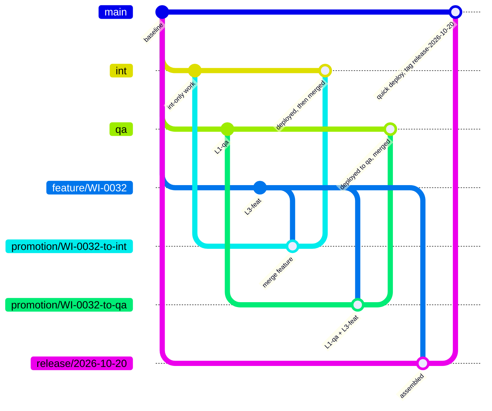
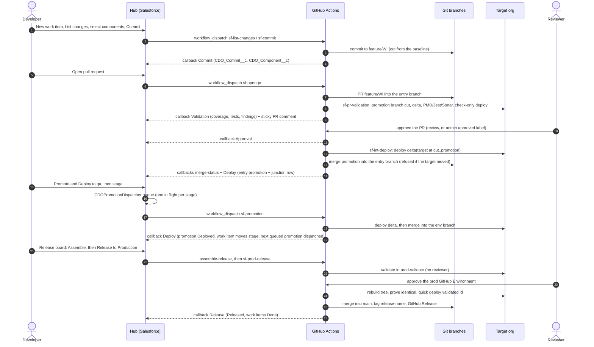
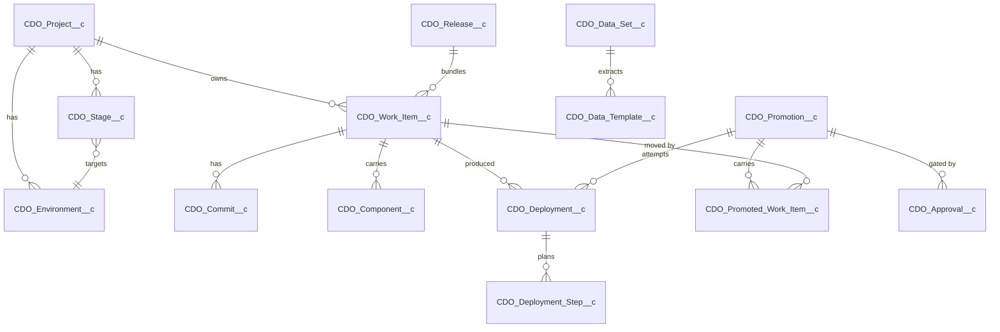

# Product design — SF DevOps

This document describes what SF DevOps is, how it is built, which decisions shaped it and what
each decision costs, where this build departs from its original specification, and the traps
that have already cost real time. It describes the code as it is. Where something has not yet
been proven end to end against live orgs, it says **Evidence: pending live run**.

Related documents: [CONTRACTS.md](CONTRACTS.md) (the integration contracts),
[DEVOPS.md](DEVOPS.md) (operator reference), [SETUP.md](SETUP.md) (installation),
[PIPELINE-USER-GUIDE.md](PIPELINE-USER-GUIDE.md) (day-to-day use).

---

## 1. The product

SF DevOps is a change-delivery platform for Salesforce, functionally comparable to Copado. A
developer picks metadata out of a developer org; it becomes a **work item**; the work item moves
stage by stage through the environment chain (for example `int → qa → stage → prod`); at every
stage it is validated, approved, deployed and merged; and every one of those steps is recorded,
queryable and reportable in Salesforce.

It has three parts:

| Part | What it is | Where it lives |
| --- | --- | --- |
| **The pipeline** | 17 GitHub Actions workflows, 4 composite actions and the scripts they call | branch `main` (`.github/workflows/`, `sf-pipeline/`) |
| **The configuration** | One YAML file, `sf-pipeline/pipeline.config.yml`, the only file a project edits | branch `main` |
| **The hub app** | A Salesforce app (`SF DevOps`, API name `SF_DevOps`) holding the records and the UI | branch `platform/sfdevops-app` |

### Why the work is not done in Salesforce

Salesforce cannot run PMD or SonarQube, cannot compute an sfdx-git-delta package, cannot hold the
git history and cannot give you free ephemeral compute. GitHub Actions can. So Actions executes.

### Why the record-keeping is not in GitHub

Release managers, QA leads and auditors work in Salesforce, not GitHub. Reports, dashboards, list
views, approvals and sharing are free there. So Salesforce records.

### The split, stated once

- **Salesforce hub org** = system of record, UI and orchestration intent.
- **GitHub Actions** = the execution engine.
- **Git** = the truth about source. An environment branch describes its org.
- They talk over exactly two contracts: an outbound `workflow_dispatch` (hub → GitHub) and inbound
  REST callbacks (GitHub → hub). See [CONTRACTS.md](CONTRACTS.md).

The hub is optional. Without the `HUB_*` secrets every callback is skipped with a notice and the
pipeline runs in **GitHub-only mode** (PRs, approvals and workflow dispatches drive it).

### Product rules, and how this build enforces each one

| # | Rule | Enforced by |
| --- | --- | --- |
| 1 | **Deploy, then merge.** A branch is merged only after the deploy to that environment succeeded | Every deploying workflow runs `promote` `mode: merge` only when the deploy outcome is `success` or `no_changes` |
| 2 | **The pull request is a review gate, never a merge path** | Branch protection requires the `sfdevops/deploy` commit status, which only the pipeline sets, and only on a deployed promotion head. A feature head never carries it, so a feature PR's merge button cannot be used (except by a repository admin on the entry branch, where protection is not enforced for admins) |
| 3 | **The delta is computed against the target environment** | `promote.sh cut` cuts `promotion/<WI>-to-<env>` from the target branch and merges the feature in; the deploy diffs `target_sha_at_cut..HEAD` |
| 4 | **Salesforce deploys whole files**, so a merge-base diff is unsafe | Rule 3. Proven by `sf-pipeline/tests/test_promotion_sim.sh` (no-clobber case) |
| 5 | **Everything of consequence writes an audit record** | Every hub callback writes one `CDO_Audit_Event__c` (append-only: a validation rule blocks edits and no permission set grants delete) |
| 6 | **Nothing hardcodes environment names, branch names or org counts** | Every workflow resolves them through `plan.py`. `ci-selftest` expands the same matrix to 3 and to 5 environments from two fixture configs |

---

## 2. Architecture



The same diagram as an editable draw.io file: [diagrams/architecture.drawio](diagrams/architecture.drawio).

**Single repository.** All composite actions are referenced locally (`uses: ./sf-pipeline/deploy`).
If you ever split them into a central repository, every `uses: ./sf-pipeline/X` becomes
`uses: <org>/<repo>/sf-pipeline/X@<ref>` and consumer repositories keep only
`pipeline.config.yml` and the workflows.

**The hub app lives on its own branch** (`platform/sfdevops-app`) and is git-ignored on `main`
(`/.platform/` and `/sfdevops-app/` in `.gitignore`). If the platform's own source sat in
`force-app/`, the delta would pick it up and every environment deploy would try to compile the
hub's Apex against `CDO_*` objects that exist only in the hub org.

### The shape of every interaction

1. A user acts in the hub (commit, open PR, validate, promote, release).
2. Apex writes the intent to a `CDO_*` record and fires `workflow_dispatch` from a `Queueable`
   (a callout cannot follow DML in the same transaction).
3. The workflow runs, deploys and POSTs a callback with the outcome.
4. Apex applies the callback: deployment row (de-duplicated), work item, promotion, environment
   health, and one `CDO_Audit_Event__c`.
5. The UI reflects it.

**Corollary:** an Apex record's status is not evidence that the workflow started. `Dispatched`
only means GitHub was asked. Only a callback writes the run URL, and `Deploying` is set only by
the `Running` callback. `CDO_PromotionReconciler` sweeps promotions that stay `Dispatched` or
`Deploying` past `Promotion_Timeout_Minutes__c` (default 90): it looks the run up on GitHub by its
`run-name`, applies a concluded run's outcome, and fails a promotion whose workflow never
started. `seed-pipeline.py` schedules the sweep every 15 minutes.

---

## 3. Branching and the delta model



Editable version: [diagrams/branching.drawio](diagrams/branching.drawio).

| Branch | Cut from | Purpose |
| --- | --- | --- |
| `main` | — | The baseline **and** the production branch in this reference configuration (`baseline_branch` and `production.branch`). It is also the default branch, which `schedule` triggers require |
| `int`, `qa`, `stage` | `main`, once, by `setup-branch-protection.sh` | One per environment, in chain order. Each describes its org. **Merged, never reset or force-pushed** |
| `feature/<WI>` | the baseline, on the work item's first commit (`sf-commit`) | So a feature reflects production, not an environment that may hold work that never ships |
| `promotion/<WI>-to-<env>` | the **target** environment branch | The deployable tree for one hop. Local only when the merge is a direct push; pushed and deleted after the merge when the merge goes through a PR |
| `release/<name>` | the production branch (`assemble-release`) | Production plus only the release's feature branches |
| `platform/sfdevops-app` | orphan | The hub app's source |

Prefixes come from `branch_prefixes` and `production.release_branch_prefix` in the config.

### The promotion-branch algorithm (`sf-pipeline/scripts/promote.sh`)

```text
cut:    fetch target and feature refs (explicit refspecs)
        checkout -B promotion/<WI>-to-<env> <target head>      → target_sha_at_cut
        git merge --no-ff <feature>                            (each feature ref in turn)
        conflict → git merge --abort, report the paths, exit 10
        deployable delta = git diff <target_sha_at_cut> HEAD   (two-dot)

deploy: the composite deploy action deploys that delta

merge:  (only after a successful deploy)
        HEAD must equal the deployed commit
        fetch target; if target head != target_sha_at_cut → refuse, exit 11
        git push origin HEAD:<target>
        rejected by protection → push the promotion branch, set the sfdevops/deploy
            status on its head, open (or reuse) a PR, merge it pinned to that head
            (--match-head-commit), retrying while GitHub registers the status;
            if the target moves meanwhile → refuse, exit 11
        neither path merged → exit 12 (never reported as success)
```

**Why not a merge-base diff.** Salesforce deploys whole files. Suppose `qa` has `L1-qa` in a file
and the feature has `L3-feat` in the same file. The feature's own copy is `L1 / L2 / L3-feat`;
deploying it **silently reverts `L1-qa` in the QA org**. The promotion merge produces
`L1-qa / L2 / L3-feat`, which keeps both. `test_promotion_sim.sh` proves this with plain git, and
proves that a conflict aborts loudly.

**Consequence:** the QA package can legitimately differ from the INT package for the same work
item, because the targets differ. That is correct.

**`delta_baseline: baseline`** is also supported for PR validation: the delta is then
`origin/<baseline_branch>..PR head`. Story-level promotions (`sf-promotion`), whole-branch
promotions (`sf-promote`) and the production release always use the target model, because their
baseline *is* the target branch.

### Destructive changes

`sfdx-git-delta` writes `destructiveChanges/destructiveChanges.xml` next to `package/package.xml`.
A deletion is a file removed in the delta range. It is applied as a post-destructive manifest when
`allow_destructive` is `true` (the default). Production forbids `NoTestRun` whenever Apex is
involved, deletions included, so a production deploy that deletes Apex or carries no Apex runs the
canary `production.destructive_tests` (`PipelineCanaryTest`), or `RunLocalTests` if the canary is
blank and Apex is being deleted.

---

## 4. The change flow



Editable version: [diagrams/change-flow.drawio](diagrams/change-flow.drawio).

### Deploy mechanics worth knowing

- **Real deploys that change Apex validate first.** When the coverage gate applies (Apex in the
  delta, `quality_gates.apex_coverage: true`, no bypass) and the level is `RunSpecifiedTests`,
  the deploy action runs a check-only validation, gates on coverage, and only then
  quick-deploys the validated id. A failed gate therefore never leaves the org ahead of the
  branch. Other deploys run `sf project deploy start` directly.
- **The deploy id is the truth, not the exit code.** `deploy.sh` starts every operation with
  `--async`, waits with `deploy resume`, then reads `sf project deploy report --json` for that id;
  `deploy_report.py` decides the outcome from `result.status`.
- **Production** validates in the reviewer-free GitHub Environment (`prod-validate`), so the
  reviewer of the `prod` environment approves a payload that already passed. The deploy job then
  rebuilds the promotion tree from the recorded SHAs, **proves its tree hash equals the validated
  tree**, quick-deploys the validated id (no second test run), merges, tags `release-<name>` and
  publishes a GitHub Release.
- **Tests come from the delta.** `specified_tests.py` resolves the tests for the changed Apex in
  three passes (the org's `ApexCodeCoverage` map capped at 25, the naming convention, changed test
  classes). When nothing resolves: a validation fails, a sandbox deploy runs `NoTestRun` with a
  warning, production refuses. `RunLocalTests` is never used as a "safe default".

---

## 5. Contracts

The two sides meet only at the contracts in [CONTRACTS.md](CONTRACTS.md):

1. **Outbound** `GitHubService.dispatchWorkflow`: `POST callout:GitHub_API/repos/{owner}/{repo}/actions/workflows/{file}/dispatches`, string inputs only, `204` expected.
2. **Inbound** Apex REST: `POST /services/apexrest/cdo/deploy-callback` (`CDO_CallbackResource`),
   `/cdo/merge-status` (`CDO_MergeStatusResource`), `/cdo/source-members`
   (`CDO_SourceMemberResource`).

The callback de-duplicates deployments: by run URL first, then by the open `Running` deployment
for the same work item (or promotion) and stage, and inserts only when both miss, so the ordinary
`Running → Success` pair leaves one row. "Latest" is always `ORDER BY CreatedDate DESC, Id DESC`.

Change a contract only by changing both sides in the same pull request and updating
CONTRACTS.md.

---

## 6. Data model summary

22 objects: 21 custom objects plus the hierarchy custom setting `CDO_Settings__c`. The single
definition is `tools/objects.yml` on branch `platform/sfdevops-app`; `tools/gen_metadata.py`
generates the object, field, tab and layout metadata from it.



| Object | Holds |
| --- | --- |
| `CDO_Project__c` | A repository, its baseline and delta mode, `Auto_Merge__c`, the config hash at the last seed |
| `CDO_Environment__c` | An org: pipeline key, type (Source / Pipeline / Production), branch, GitHub Environment, `Health_Status__c` |
| `CDO_Stage__c` | A position in the chain: order, gate type (Review / Self_Service / Required_Reviewer), entry and production flags |
| `CDO_Release__c` | Work items that ship to production together; release branch, tag, validated deploy id |
| `CDO_Work_Item__c` | The unit of change (`WI-0001`): status, current stage, feature branch, PR, review state, coverage, specified tests |
| `CDO_Commit__c` / `CDO_Component__c` | Commits, and each component a work item carries (`Unique_ID__c` = `Type:Member`) |
| `CDO_Promotion__c` / `CDO_Promoted_Work_Item__c` | A hop from one stage to the next, and **the junction** naming the work items it carried |
| `CDO_Deployment__c` / `CDO_Deployment_Step__c` | One deploy attempt with its test results; manual or scripted pre/post steps |
| `CDO_Approval__c` | An approval decision (Review, Label, Manual, Environment) |
| `CDO_Scan_Finding__c` | A PMD (or Sonar) finding |
| `CDO_Test_Script__c` / `CDO_Test_Result__c` | Manual tests and their outcomes |
| `CDO_Audit_Event__c` | Append-only history |
| `CDO_Webhook__c` | Outbound notification targets |
| `CDO_Component_Dependency__c` | Dependency edges between components |
| `CDO_Data_Set__c` / `CDO_Data_Template__c` / `CDO_Data_Relationship__c` | Records-not-metadata deployment |
| `CDO_Settings__c` | GitHub owner, repo, workflow ref, Named Credential, dispatch switch, promotion timeout |

**The junction matters more than it looks.** Without `CDO_Promoted_Work_Item__c` a promotion
cannot say what it carried, `resolvePromotedWorkItems` has nothing to resolve and the promotion
stays `Deploying` forever. Junction rows are written at every entry point:
`CDOPromotionDispatcher.requestPromotion`, and the entry-hop promotion the callback service
creates when `sf-int-deploy` reports a deploy with no promotion id. A queued promotion without
junction rows is failed rather than dispatched.

### Hub app inventory

| Kind | Count | Names |
| --- | --- | --- |
| Objects | 22 | above |
| Apex classes | 31 | the spec's 30 (12 services, 14 controllers, 4 test classes) plus `CDO_ControllerTests` |
| Lightning web components | 13 | `cdoPipeline`, `cdoCommit`, `cdoPromote`, `cdoPromoteAction`, `cdoPromoteDeployAction`, `cdoWorkItemCommandCenter`, `cdoNewWorkItem`, `cdoReleaseBoard`, `cdoDeploymentSteps`, `cdoDataDeployer`, `cdoGovernance`, `cdoDora`, `cdoUtils` |
| App, pages, tabs | 1 / 6 / 17 | `SF_DevOps`; `CDO_Pipeline_Home`, `CDO_Release_Board`, `CDO_Delivery_Metrics`, `CDO_Data_Deploy`, `CDO_Work_Item_Record_Page`, `CDO_Promotion_Record_Page` |
| Quick actions | 2 | `CDO_Work_Item__c.Promote`, `CDO_Work_Item__c.Promote_and_Deploy` |
| Custom permissions | 5 | `CDO_Approve_Entry`, `CDO_Run_Prod_Release`, `CDO_Governance_Ops`, `CDO_Configure_Pipeline`, `CDO_Bypass_Gates` |
| Permission sets / groups | 4 / 4 | `CDO_User`, `CDO_Developer`, `CDO_Release_Manager`, `CDO_Pipeline_Admin`; `CDO_Developer_Access`, `CDO_Release_Manager_Access`, `CDO_Pipeline_Admin_Access`, `CDO_Admin_Access` |
| Credentials | 1 + 1 | Named Credential `GitHub_API` → External Credential `GitHub_API_Credential` (principal `GitHub_PAT`, parameter `Token`) |

---

## 7. Quality gates, approvals and roles

### Gates

| Gate | Fires when | Enforced where | Without its tooling |
| --- | --- | --- | --- |
| PMD | `*.cls` / `*.trigger` added or changed | `quality` job; priority 1–2 violations block (`sf-pipeline/config/pmd/ruleset.xml`) | — |
| LWC Jest | an LWC bundle changed | `quality` job | skipped with a warning when `package.json` lacks `@salesforce/sfdx-lwc-jest` |
| SonarQube | Apex or LWC/Aura JS changed | `quality` job | skipped with a warning while `SONAR_TOKEN` / `SONAR_HOST_URL` are unset |
| Apex coverage | Apex in the delta | during the org deploy, threshold `coverage_threshold` (85) | — |

The quality job runs only on PR validation. Promotions rely on the validation that preceded them
plus the coverage gate in the deploy.

**Bypass.** The `bypass-quality-gates` label is honoured only if the person who added it has
admin or maintain permission, re-verified at run time through
`GET /repos/{owner}/{repo}/collaborators/{login}/permission`. Anyone else's label is removed with
a comment. Under bypass, PMD, Sonar and Jest become advisory, and tests and coverage are skipped in
sandboxes; production still runs its canary when Apex is involved.

### Approvals

| Stage | How approval happens |
| --- | --- |
| Entry (`int`) | A native GitHub review approval, **or** the `approved` label added by someone with admin/maintain permission. A non-admin's label is removed, the PR is told why, and nothing deploys |
| Later stages (`qa`, `stage`) | Developer self-service from the hub (or the `approved` label on a PR into those branches) |
| Production | GitHub Environment `prod` with a required reviewer, after validation in `prod-validate` |

Approval **starts** the entry deploy (`sf-pr-approved` calls `sf-int-deploy`). It is held back,
with a PR comment, when the latest validation of the PR's head commit has not reported, did not
pass, or measured coverage below `coverage_threshold`.

### Roles

| Role | Permission set group | Can |
| --- | --- | --- |
| Developer | `CDO_Developer_Access` | Create work items, commit, open PRs, validate, promote through the non-production stages |
| Release manager | `CDO_Release_Manager_Access` | The above, plus releases, data sets, approve the entry stage in the hub (`CDO_Approve_Entry`), run production releases (`CDO_Run_Prod_Release`) |
| Pipeline admin | `CDO_Pipeline_Admin_Access` | Full object control, every Apex class including the REST resources, settings, governance ops, configuration. The callback integration user needs at least this group |
| Admin | `CDO_Admin_Access` | All four permission sets |

GitHub-side gates (labels, environment reviewers) are governed by repository permissions, not by
these groups.

---

## 8. Concurrency, locking and conflicts

- **One concurrency group per environment branch** (`sf-deploy-<branch>`, `cancel-in-progress:
  false`) on every deploying job: the entry deploy, story-level and whole-branch promotions, and
  rollbacks. The production release has its own group (`sf-prod-release`).
- **A GitHub concurrency group is not a queue.** One run executes, exactly one waits, and a third
  arrival evicts the waiting one. The real queue is in Apex: `CDOPromotionDispatcher` keeps one
  promotion in flight (`Dispatched` or `Deploying`) per target stage, dispatches the oldest
  `Queued` one first (`ORDER BY CreatedDate, Id`) and locks the stage row (`FOR UPDATE`) so two
  finishing promotions cannot both dispatch.
- **Salesforce serialises deploys per org.** A long validation blocks a real deploy behind it.
  PR validations do not share the deploy concurrency group, so a validation and a deploy can be
  queued at the same org at once; Salesforce runs them one after the other.
- **Conflict pre-checking:** `sf-conflict-check` joins in-flight work items on the component
  Unique ID (`Type:Member`), from git feature branches and from hub `CDO_Component__c` rows, on
  every feature-branch push, every three hours on weekdays and on demand.
- **Merge conflicts are detected at the promotion-branch merge**, not at the PR. On conflict:
  `git merge --abort`, comment the paths on the PR, report `Conflict` to the hub (work item
  `Blocked`, `Merge_State__c = Conflict`, `Conflict_Paths__c`), fail the job.
- **Target moved:** the post-deploy merge refuses when the target head is no longer
  `target_sha_at_cut`. Under strict branch protection GitHub refuses it too.

---

## 9. Where each number comes from (as implemented)

| Number | Source |
| --- | --- |
| Coverage threshold of the deploy gate | `coverage_threshold` in the YAML, for every environment |
| Coverage that holds an approval | `coverage_threshold` (in `sf-pr-approved`) |
| Coverage that disables Promote in the hub | the work item's `Minimum_Coverage__c` against `Last_Coverage__c` |
| Test level | promotion option (from the work item's `Test_Level_Override__c`) → `environments[].test_level` → `RunSpecifiedTests` |
| Tests | bypass → explicit tests (PR body `Specified-Tests:` for validation and the entry deploy; the work items' `Specified_Tests__c` for hub promotions and releases) → a broader configured level → resolution from the delta |
| Baseline of a promotion | the target environment branch at the moment of the cut |
| Production canary | `production.destructive_tests` |
| Promotion timeout | `CDO_Settings__c.Promotion_Timeout_Minutes__c` (90) |

---

## 10. Decisions and their costs

### From the specification

| Decision | Cost accepted | How this build handles it |
| --- | --- | --- |
| Salesforce is the record, Actions is the engine | Two systems to keep in step; a callback that does not fire leaves a stale record | Callbacks retry on 5xx; the reconciler sweep applies lost outcomes from GitHub every 15 minutes |
| Feature branches cut from the baseline | More frequent `CONFLICT (add/add)` at the entry hop | The conflict is real; it is commented on the PR with the paths |
| The pull request is a review gate, never a merge path | The entry hop needs a promotion like every other hop | `sf-int-deploy` cuts `promotion/<WI>-to-<entry>` |
| Promotions are story-level | A promotion branch per work item per hop | Local-only when a direct push merges; pushed, PR-merged and deleted under protection |
| Tests resolved from the delta | A class with no test deploys to sandboxes with `NoTestRun` | Validation fails and production refuses for the same change |
| Approval starts the promotion | Less control over exactly when the entry deploy runs | Held when the head commit's validation is missing or red, or coverage is low |
| One concurrency group per environment branch | Simultaneous approvals can lose the middle one | Hub-dispatched promotions queue in Apex; direct GitHub approvals are still subject to this |
| Platform source on its own branch | Two branches to check out to work on the whole system | A worktree under the git-ignored `.platform/hub` keeps both side by side |
| Environment health derived from deployments | Health is only as fresh as the last deploy | A brand-new environment shows a **blank** health (no picklist default), not a guess |
| Promotions queued in Apex | A promotion can wait behind another rather than failing fast | One in flight per target stage |

### This build's own decisions

| Decision | Why | Cost accepted |
| --- | --- | --- |
| **SFDX auth URL is the default CI sign-in**; JWT stays supported | Salesforce now refuses new Connected Apps in many orgs ("You can't create a connected app") | The secret is a refresh token from a CLI login: it acts as that user, lives until revoked, and grants org access to anyone who obtains it. JWT stores no refresh token but needs a Connected App or External Client App per org |
| **Validate, then quick-deploy** real deploys that change Apex | A failed coverage gate must never leave the org ahead of the branch | Two org operations per such deploy |
| **PR-path merge under branch protection** (push first, then promotion PR + `sfdevops/deploy` status + pinned merge) | Protected branches reject plain pushes; strict "up to date" protection makes GitHub itself refuse a merge when the target moved | One extra PR per protected hop; GitHub needs a moment to register the status (the merge retries); without `GH_PAT` the repository must allow Actions to create PRs |
| **A separate hub org** (`sfp-hub`) | Platform objects and Apex never share an org with business metadata, and nothing in production depends on the hub | One more org to keep alive and credential |
| **LF line endings** forced by `.gitattributes` (`* text=auto eol=lf`) | `core.autocrlf` on Windows would commit CRLF scripts that fail on Linux runners | Windows editors must cope with LF |
| **Production rebuild-and-prove** before quick deploy | The reviewer must approve exactly what was validated | A second job rebuilds the tree |
| **Admin `approved` label on the entry stage** | GitHub blocks PR authors from approving their own PR; a single-maintainer repository has no second reviewer | The label is a weaker signal than an independent review |
| **The hub is optional** | Adopters can start with GitHub alone | No records, queue, reconciler or audit trail without it |
| **Optional integrations degrade** (Sonar, Jest, Webex) | An adopter's first run must not fail on a missing optional secret | A skipped gate is only a warning in the log |
| **A failed callback is a warning**, not a failed deploy (unless `HUB_CALLBACK_STRICT=true`) | A hub outage must not roll back delivery | The hub can lag until the reconciler or the next callback catches up |
| **Release branches are assembled from production plus only the release's feature branches** | Production receives exactly what was planned | The release tree is not the tree that sat in `stage`; it is validated against production before release |

---

## 11. Specification gaps and deviations

| # | Specification | This build | Why |
| --- | --- | --- | --- |
| 1 | §2 says 23 `CDO_*` objects | **22**: 21 custom objects + the `CDO_Settings__c` hierarchy custom setting | §9.1 lists 22 |
| 2 | §10 lists an LWC Jest gate with no config key | `quality_gates.jest` added | The gate needs a switch |
| 3 | Canary `AIAssistantForSalesControllerTest` | `PipelineCanaryTest` in the sample `force-app` | The spec's class does not exist here |
| 4 | Filename `sf-int-deploy.yml` contains an environment name, yet §16 forbids hardcoding one | Filename kept; contents generic: it deploys to whatever environment the PR's base branch resolves to | Keeps the spec's interface |
| 5 | 4 hub test classes | The 4 plus `CDO_ControllerTests` | Controller coverage |
| 6 | Entry approval by a second reviewer | Single-maintainer repositories use the admin `approved` label | GitHub forbids self-approval |
| 7 | §12.2 Connected App + JWT per org | Auth URL default; JWT optional (Connected App or External Client App) | New Connected Apps are blocked |
| 8 | §2 diagram draws `dev` inside the chain | `dev` is a source org only | Commits are retrieved from it; nothing deploys to it |
| 9 | Branches `gh-actions-*`; app named after the original implementation | `main` / `int` / `qa` / `stage`; app `SF_DevOps`, source dir `sfdevops-app/` | `schedule` triggers run only on the default branch, which is the baseline here; neutral naming for an open-source project |
| 10 | 17 workflows | 17 plus `ci-selftest` and `sf-auth-check` | Self-tests without secrets; an auth smoke test |
| 11 | `plan.py` has 4 modes | 5: adds `source <name>` for commit workflows | Source orgs are not chain environments |
| 12 | Config keys as listed | Adds `branch_prefixes`, `approved_label`, per-org `org_alias`, `production.name`, `hub.org_alias` (and optional `hub.project_key`) | Setup scripts need aliases; nothing else is hardcoded |
| 13 | Callback contract as listed | Extended (release id, more event types, approval fields, deploy id, findings) plus `/cdo/merge-status` and `/cdo/source-members` | Unknown attributes are ignored, so additions do not break older hubs |
| 14 | §5 merge is a plain `git push` | Push first, then the protected-branch PR path | Protected branches reject plain pushes |
| 15 | §12.6 coverage floor: stage floor → work item minimum → YAML | Deploy gate uses `coverage_threshold`; the hub uses the work item minimum to disable Promote; `CDO_Stage__c.Coverage_Floor__c` is displayed but not enforced | Kept the gate in one place |
| 16 | `Health_Status__c` "reports the picklist default" | No default; blank until something deploys | A restricted picklist has no honest "unknown" value |
| 17 | `Remote Site Setting` for api.github.com | Not needed | The Named Credential covers it |
| 18 | One-command install | Source deploy in a documented order is the primary install today; the unlocked package `SF DevOps` (no namespace) is defined in the hub's `sfdx-project.json` but a version may not exist yet | Planned |
| 19 | Credentials set by hand per §12.2 / §12.3 | `bootstrap_secrets.py` creates the GitHub Environments (prod with a required reviewer) and every secret, and stores the GitHub token in the hub's External Credential; it never prints a value | Setup must be repeatable |

---

## 12. Traps

### Salesforce metadata

- **A Percent field's `defaultValue` is a fraction.** `<defaultValue>75</defaultValue>` stores
  7500 %. Values written through the API are literal (`85` = 85 %). The hub generator refuses a
  Percent default.
- **Deploying a field grants no field-level security**, not even to the System Administrator
  running the tests. Code that queries `WITH USER_MODE` then fails with `No such column`. Tests
  must run as a user holding the permission set: the sample `InvoiceTestData.invoiceUser()`
  creates one with `Invoice_User`, and the tests run inside `System.runAs`. The same rule is why
  the hub generator writes FLS for every field into the permission sets.
- **App visibility is a separate grant from tabs.** `CDO_User` grants `applicationVisibilities`
  for `SF_DevOps`; without it the App Launcher is empty even with every tab, object and class.
- **Permission sets are additive and cannot revoke** what a profile grants.
- **Apex forbids two `@AuraEnabled` methods of the same name**, so `promote` and
  `promoteAndDeploy` are two action names that wrap one private method.
- **Lightning record actions cannot take design attributes**, so two actions that differ only in
  behaviour need two LWC bundles (`cdoPromoteAction`, `cdoPromoteDeployAction`).
- **A layout cannot reference a quick action created in the same deploy.** Deploy quick actions
  first, layouts second.
- **`PermissionSetGroup.description` caps at 255 characters.**
- **A restricted picklist has no room for "not known yet."** Code that means "nothing deployed
  here" leaves `Health_Status__c` blank.
- **A component with no page still deploys, compiles and passes its tests.** Only opening the app
  catches it.
- **The record-detail component on a flexipage is `force:detailPanel`**, not
  `force:recordDetail`.
- **An XML comment before the root element breaks sfdx source parsing.** Generated files carry
  their marker comment just inside the root element.

### Deploys and the CLI

- **`| tail` throws away the exit code.** Use `set -o pipefail`, or do not pipe.
- **The CLI exit code also fails the other way:** a deploy the org accepted in full can exit
  non-zero because polling lost its connection. Believe `sf project deploy report` for the deploy
  id.
- **`RunSpecifiedTests` only counts coverage from the tests you name.** A class covered entirely
  by a test you left off scores zero.
- **Deploying the whole folder gates on classes you did not touch.** Deploy the delta;
  `--ignore-conflicts` covers stale source-tracking state.
- **Production refuses to delete Apex without tests.** Hence the canary.
- **Salesforce serialises deploys per org.**
- **`sf org open --url-only` frontdoor URLs are single-use.**
- **The sf CLI redacts secrets in `sf org display`.** With sf 2.153.5 both `accessToken` and
  `sfdxAuthUrl` come back redacted in `sf org display --json`, with or without `--verbose`, and the
  redacted text is not empty, so a naive "is it set?" check passes and a useless value gets
  stored. So nothing here reads a token: `bootstrap_secrets.py` reads the auth URL from
  `sf org auth show-sfdx-auth-url --no-prompt` and checks it starts with `force://`, and every REST
  call (hub callbacks, the Named Credential token) goes through `sf api request rest`, which signs
  with the CLI's own session and takes the body on stdin. Its URL argument has no leading slash
  (`services/apexrest/...`); with one, it answers 404.
- **Salesforce blocks creating new Connected Apps** in many orgs: "You can't create a connected
  app. To enable connected app creation, contact Salesforce Customer Support." Use the SFDX auth
  URL, or an External Client App for JWT.

### Git, GitHub and the workstation

- **A GitHub concurrency group is not a queue** (one running, one pending, a third evicts the
  pending one).
- **Protected branches reject a force push and a plain push** when the branch requires a PR. A
  workflow must handle that, not report success through it.
- **`pull_request_review` workflows run from the PR's base branch**, so the pipeline files must
  exist on every environment branch. Create the environment branches from the finished baseline.
- **GitHub blocks a PR author from approving their own PR.**
- **A PR opened with `GITHUB_TOKEN` does not trigger workflows.** `sf-open-pr` opens PRs with
  `GH_PAT` when set, and otherwise dispatches `sf-pr-validation` explicitly.
- **A pushed commit is not a deployed commit.** Confirm the org, not the branch.
- **Fetching a non-default ref namespace needs an explicit refspec.**
  `git ls-tree origin/platform/sfdevops-app` returns nothing until
  `git fetch origin 'refs/heads/platform/*:refs/remotes/origin/platform/*'`. Every script fetches
  with explicit refspecs.
- **`core.autocrlf` breaks bash scripts on Linux runners.** `.gitattributes` forces LF.
- **On Windows, `python3` can be the Microsoft Store stub**, which exists on `PATH` but cannot run.
  The scripts probe `python3`, `python` and `py` and use the first that actually runs; on Windows
  run `py`.
- **Git Bash rewrites `/CN=...` arguments into Windows paths.** Set `MSYS_NO_PATHCONV=1` for
  `openssl req -subj "/CN=..."` (`bootstrap_secrets.py` does).

### Data and Apex

- **`ORDER BY CreatedDate` alone is ambiguous.** Order by `Id` as well.
- **A missing identifier is not a reason to insert** (the callback de-dup rule).
- **An Apex record's status is not evidence that its workflow started.** Only the callback writes
  the run URL.

---

## 13. Verification status

| Area | Status | Evidence |
| --- | --- | --- |
| `plan.py` on 3- and 5-environment configs | Verified | Python unit tests; `ci-selftest` matrix jobs |
| Promotion algorithm: no clobber, conflict abort, target-moved refusal, protected-push failure, deterministic rebuild | Verified | `test_promotion_sim.sh`, 27 assertions, pure git |
| Delta (with the real sfdx-git-delta), test resolver, profiles, deploy report, manifest, conflict check, commit helper, data plan, audit, sign-in and callback scripts, Sonar gate, Webex | Verified | `bash sf-pipeline/tests/run_tests.sh`: 100 Python unit tests and 8 bash test files (280 assertions), all passing locally on 2026-10-13; `ci-selftest` runs the same suite on every push |
| Workflow syntax | Verified | actionlint 1.7.12, no findings |
| Sample metadata on the five reference orgs | Verified | `onboard-org.sh`: 22 components, 7/7 tests on each org ([build log](build-log/session-1.md)) |
| Connected App creation blocked | Observed | Check-only deploy of a probe app returned the error quoted above |
| Hub metadata layer in `sfp-hub` | Deployed | Objects, credentials, tabs, layouts ([build log](build-log/session-1.md)) |
| Setup scripts | Dry runs | `bootstrap_secrets.py --dry-run`, `seed-pipeline.py --dry-run`, `setup-branch-protection.sh --dry-run` |
| Every workflow end to end against live orgs (validation, approval gates, promotions, production release, callbacks, data deploy, ops) | **Evidence: pending live run** | Needs the secrets the maintainer sets with `bootstrap_secrets.py` |
